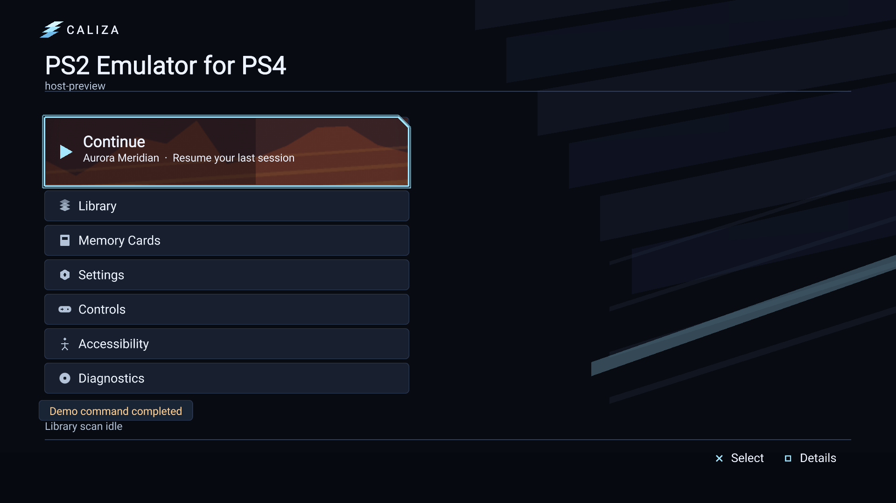
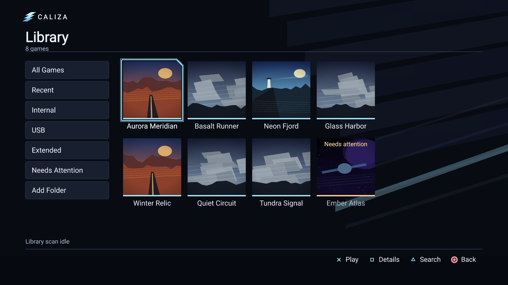
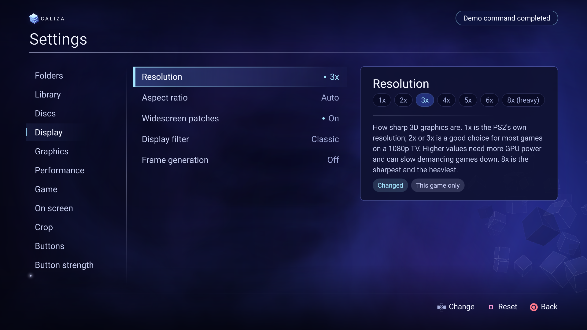
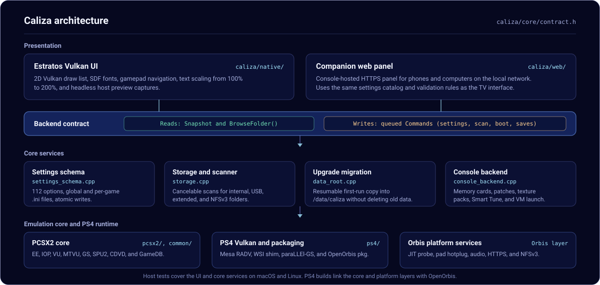

<p align="center">
  
</p>

<h1 align="center">Caliza</h1>

<p align="center">
  Native PlayStation 2 emulator for PS4, ported from <a href="https://github.com/PCSX2/pcsx2">PCSX2</a>.
</p>

<p align="center">
  <a href="https://github.com/felipebasurto/caliza/releases/latest">
    
  </a>
</p>

<p align="center">
  <a href="#how-it-works">How it works</a> ·
  <a href="#features">Features</a> ·
  <a href="#install">Install</a> ·
  <a href="#storage-and-upgrading">Storage</a> ·
  <a href="#controls">Controls</a> ·
  <a href="#architecture">Architecture</a> ·
  <a href="#build-from-source">Build</a>
</p>

> [!NOTE]
> Caliza is experimental. Host tests on macOS and Linux verify the interface, settings schema, storage scanner, migration code, and companion panel. OpenOrbis compiles and validates the PS4 package. Full validation on real PS4 hardware is still in progress. Check [project status](ps4/STATUS.md) and [compatibility notes](ps4/COMPATIBILITY.md) before relying on a build.

## How it works

<p align="center">
  
</p>

Caliza combines the [PCSX2](https://github.com/PCSX2/pcsx2) emulation core and the Mesa RADV Vulkan driver with Estratos, a television interface built for gamepad control. Every screen uses large text, full controller navigation, and inline descriptions for each setting.

<p align="center">
  
</p>

## Features

- **In-place game library.** Add folders from internal storage, USB drives, extended storage, or NFSv3 network shares. Filter by recent titles, storage location, or items that need attention. Caliza reads `.iso`, `.chd`, `.cso`, and `.zso` images in place without moving, renaming, or modifying them.
- **Global and per-game settings.** Set internal resolution, renderer, aspect ratio, widescreen patches, texture replacements, and hardware fixes for all games or for one title. Supported renderers are Vulkan RADV, optional paraLLEl-GS, and software fallback. Experimental Smart Tune tests graphics settings during play and saves the winning profile.
- **Memory cards and save states.** Create and assign memory cards per slot or per game. Save and load states with controller shortcuts, backup fallback, and atomic writes.
- **Controls.** Remap interface and emulator shortcuts, stick behavior, dead zones, and rumble strength.
- **Accessibility.** Scale text from 100% to 200%, enable high-contrast mode, reduce background motion, and widen focus outlines.
- **Companion panel.** The console serves an HTTPS web panel on your local network. Scan the QR code on the Diagnostics screen from a phone or computer to browse the library, edit settings without on-screen typing, manage folders, and download diagnostic reports.

<p align="center">
  
  
</p>

## Requirements

- A PlayStation 4 console that can install and run homebrew packages.
- A PlayStation 2 BIOS image dumped from your own console.
- Disc images made from PlayStation 2 games you own.

### Your games and BIOS

Caliza does not include, download, or link to BIOS files, firmware, decryption keys, or copyrighted games, and it will not help you find them.

- **BIOS.** Dump the BIOS from your own PlayStation 2 where permitted by local law.
- **Games.** Create images from discs you own, or use copies provided by publishers under their terms.

Do not upload BIOS files, keys, or game images to this repository or attach them to bug reports.

## Install

<p>
  <a href="https://github.com/felipebasurto/caliza/releases/latest">
    
  </a>
</p>

1. Download the `.pkg` and its `.txt` SHA-256 checksum file from [GitHub Releases](https://github.com/felipebasurto/caliza/releases/latest).
2. Verify the download before installing. Run `shasum -a 256 -c <checksum-file>` on macOS, or `sha256sum -c <checksum-file>` on Linux.
3. Install the `.pkg` with your console's package installer. Caliza appears on the home screen.
4. Open Caliza. First-run setup asks for a BIOS folder such as `/data/caliza/bios/` and at least one game folder on internal storage, USB, or an NFSv3 share.
5. Select a game and press Cross to start it.

> [!TIP]
> Start your first test with an uncompressed `.iso` on internal storage at native 1x resolution. Once that boots, try USB drives, compressed `.chd` or `.zso` images, and higher resolutions.

## Storage and upgrading

<p align="center">
  
</p>

Everything Caliza writes lives inside `/data/caliza/`.

| Folder | Contents |
| --- | --- |
| `bios/` | User-dumped PS2 BIOS files |
| `games/` | Default internal game folder |
| `memcards/` | Global and per-game memory cards |
| `savestates/` | Save-state slots and backups |
| `settings/` | Global and per-game `.ini` configuration files |
| `patches/` | PCSX2 widescreen and game-fix patch files |
| `textures/` | Optional texture replacement packs |
| `logs/` | `boot.log` and `emulog.txt` diagnostic logs |

### Upgrading from earlier builds

Earlier development builds stored user data in a different folder. On first launch, Caliza copies settings, BIOS files, memory cards, and patches into `/data/caliza/`.

- Interrupted copies resume on the next launch.
- Existing files in `/data/caliza/` are never overwritten.
- The previous folder is never modified or deleted.
- Game images and texture packs stay where they are without duplication.

Check `[migrate]` lines in `/data/caliza/logs/boot.log` if anything did not copy.

## Controls

### Menus and library

| Button | In menus | In the library |
| --- | --- | --- |
| Cross | Select | Start game |
| Circle | Back | Back |
| Square | Details or reset | Game details |
| Triangle | — | Search |
| D-pad | Move | Move |

### In-game shortcuts

| Default shortcut | Action |
| --- | --- |
| L3 + R3 (press and release alone) | Open or close the in-game pause menu (default preset; resume, save/load slots 1–10, disc swap, return to library) |
| Options | PS2 Start |
| L3 + R3 + D-pad Up | Quick save state to slot 1 |
| L3 + R3 + D-pad Down | Quick load state from slot 1 |
| L3 + R3 + D-pad Right | Switch to the next disc in a multi-disc set |
| Hold L1 + R1 and click Touchpad | End the session and return to the library (unless `L1 + R1 + Touchpad` is chosen as the pause trigger) |
| Hold L2 + D-pad Down for 2 seconds | Open the companion panel or show its QR code |

Inside the pause menu, move with the D-pad or left stick, pick a save slot (1–10) or target disc with Left/Right or L1/R1, confirm with Cross, and resume with Circle or the pause trigger.

On first game launch (or after migrating a legacy Share/Create pause binding), Caliza prompts you to pick one of 6 pause menu presets (all avoiding Share/Create and PS reserved by PS4/GoldHEN), pre-selecting **L3 + R3**:

- **L3 + R3** *(default)* — Press and release both sticks alone. Triggers on release only if no other button was pressed during the hold, keeping `L3 + R3 + D-pad` quick save/load/disc shortcuts and Select/Start free (disables the `L3 + R3` present-filter cycle).
- **Touchpad click** — Single press, intercepted so it never leaks Select. Warning: Touchpad acts as PS2 Select; choosing it means Select must be mapped to another button for games that use it (the chooser and companion web panel offer one-step remapping of R3 to Select).
- **L3 + R3 + L1** — Hold both sticks and press L1. Keeps Touchpad (Select) and Options (Start) free; requires three buttons.
- **Hold Touchpad (0.5 s)** — Hold Touchpad for 0.5 s to pause; a short tap still sends PS2 Select on release (slight delay on Select).
- **L1 + R1 + Touchpad** — Hold L1 + R1 and click Touchpad. Keeps single Touchpad click as PS2 Select; replaces the legacy instant exit shortcut.
- **Hold Options (0.5 s)** — Hold Options for 0.5 s to pause. Options is PS2 Start; a short tap sends Start on release (avoid if a game needs Start held).

You can change the preset anytime in **Controls** (`Caliza/PauseTrigger`) or in the companion web panel. Legacy `Caliza/PauseButton1`/`PauseButton2` bindings migrate automatically to the closest preset, and legacy Share/Create bindings clear to unchosen so the first-run chooser appears.

## Architecture

<p align="center">
  
</p>

Both interfaces read immutable `Snapshot` values and queue `Command` updates through [`caliza/core/contract.h`](caliza/core/contract.h). That keeps scanning, settings validation, migration, and boot handoff in one host-testable backend.

| Path | Role |
| --- | --- |
| [`caliza/`](caliza/) | Estratos Vulkan 2D interface, backend contract, settings schema, storage and migration engine, host preview, and companion web panel |
| [`ps4/`](ps4/) | PS4 build system, Vulkan WSI shim, crash hooks, OpenOrbis packaging, brand assets, and validation scripts |
| [`pcsx2/`](pcsx2/), [`common/`](common/) | Upstream PCSX2 emulation core and shared utilities |

See [`REPO-MAP.md`](REPO-MAP.md) for the full repository layout and remaining cleanup tasks.

## Build from source

### 1. Fast host tests

Run unit tests for the UI model, pause menu, settings schema, settings projection, console backend, storage scanner, migration, companion web panel, and brand audits on macOS or Linux.

```sh
bash tests/caliza/run-all.sh
python3 tests/caliza/audit_feature_parity.py
```

### 2. Interface preview

Render every Estratos screen to PNG on the host with Vulkan.

```sh
bash caliza/host/build-host.sh
bash caliza/host/capture-estratos.sh
```

### 3. PS4 package

Building the console `.pkg` requires Linux or WSL, Clang with the [OpenOrbis PS4 Toolchain](https://github.com/OpenOrbis/OpenOrbis-PS4-Toolchain), Mesa RADV, and the dependencies listed in [`ps4/Makefile.ps4`](ps4/Makefile.ps4). See [`ps4/PS4_PLATFORM.md`](ps4/PS4_PLATFORM.md) for setup notes.

```sh
bash ps4/build-ps4.sh package
```

`python3 ps4/tools/make_brand_assets.py` generates the logo, console icon, and companion-panel marks from one source.

## Reporting issues

Include these details in every bug report:

- Caliza version or commit hash.
- PS4 model and system software version.
- Game serial such as `SLUS-XXXXX` and storage type, whether internal, USB, or NFS.
- Steps to reproduce the issue.
- `boot.log` and `emulog.txt` from `/data/caliza/logs/`, with private paths or network details removed.

The Diagnostics screen shows the companion panel URL and QR code, where you can download a diagnostic report from a browser.

Further reading: [Project status](ps4/STATUS.md), [compatibility](ps4/COMPATIBILITY.md), [known issues](ps4/KNOWN_ISSUES.md), [performance guide](PERFORMANCE.md), and [hardware QA guide](ps4/CONSOLE-QA.md).

## License and credits

Caliza is free software under the [GNU General Public License, version 3 or later](COPYING.GPLv3).

- **Emulation core.** Modified [PCSX2](https://github.com/PCSX2/pcsx2) code, copyright 2002 to 2026 the PCSX2 Dev Team and contributors under GPLv3+.
- **Console platform and graphics.** Built with the [OpenOrbis PS4 Toolchain](https://github.com/OpenOrbis/OpenOrbis-PS4-Toolchain), [Mesa RADV](https://docs.mesa3d.org/drivers/radv.html), GPL-licensed Orbis adaptation code, and optional paraLLEl-GS compute rendering. See [`ps4/PORT-THIRD-PARTY.txt`](ps4/PORT-THIRD-PARTY.txt) for full notices.
- **Fonts.** Roboto under the Apache License 2.0 and PromptFont under the SIL Open Font License 1.1.
- **Interface, diagrams, and branding.** Original work for Caliza, documented in [`caliza/ASSETS.md`](caliza/ASSETS.md).

Caliza is an independent, non-commercial project. It is not affiliated with, endorsed by, or sponsored by Sony Interactive Entertainment or the PCSX2 project. "PlayStation", "PS2", and "PS4" are registered trademarks of Sony Interactive Entertainment Inc., used only to identify the platforms involved.
