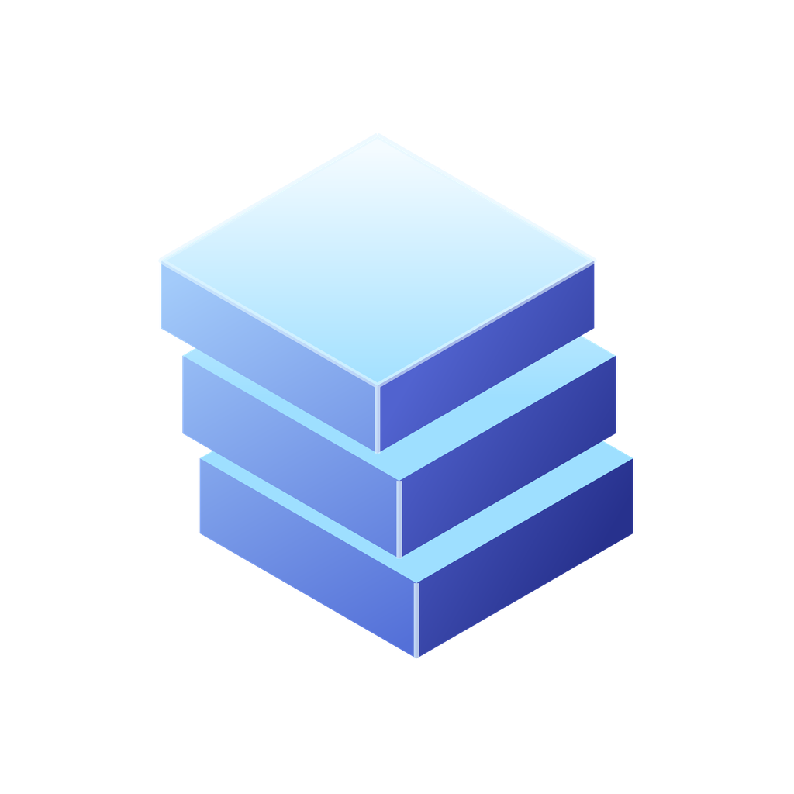
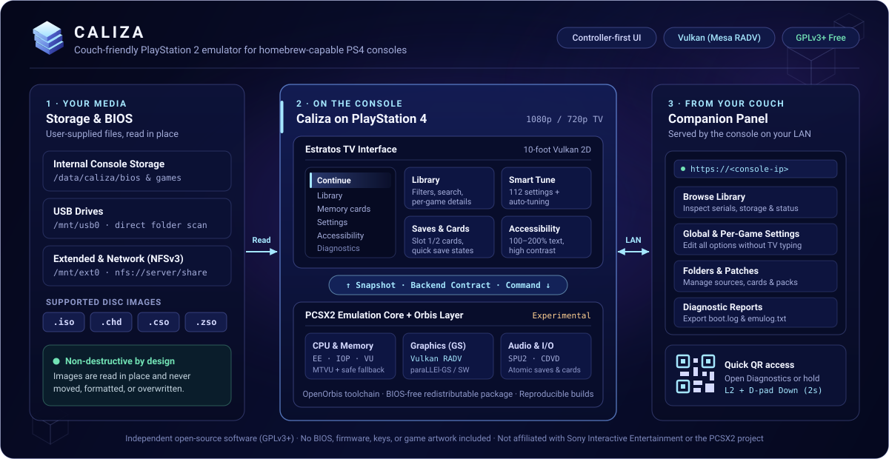
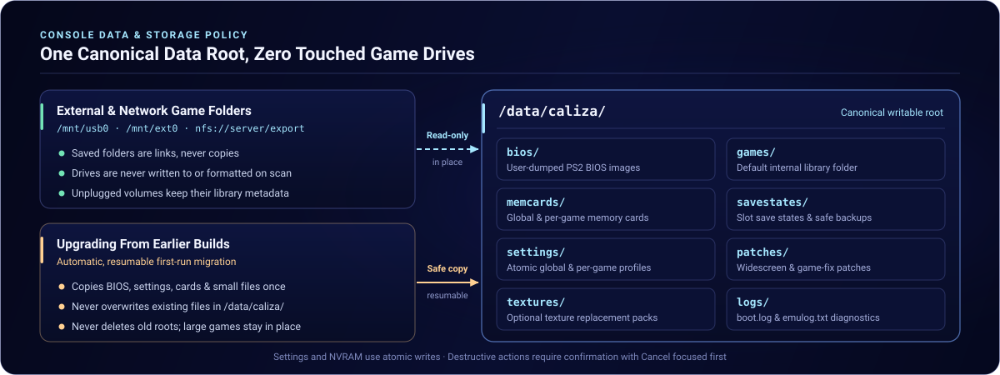

<p align="center">
  
</p>

<h1 align="center">Caliza</h1>

<p align="center">
  <strong>A couch-friendly PlayStation 2 emulator for homebrew-capable PlayStation 4 consoles.</strong><br>
  Built on the <a href="https://github.com/PCSX2/pcsx2">PCSX2</a> emulation core with an original 10-foot Vulkan interface and LAN companion panel.
</p>

<p align="center">
  <a href="https://github.com/felipebasurto/caliza/releases/latest">
    
  </a>
</p>

<p align="center">
  <sub>PS4 homebrew <code>.pkg</code> + SHA-256 checksum on <a href="https://github.com/felipebasurto/caliza/releases">GitHub Releases</a> · No BIOS or games included</sub>
</p>

<p align="center">
  <a href="#how-it-works">How it works</a> ·
  <a href="#features">Features</a> ·
  <a href="#install">Install</a> ·
  <a href="#storage-and-upgrading">Storage</a> ·
  <a href="#controls">Controls</a> ·
  <a href="#architecture">Architecture</a> ·
  <a href="#build-from-source">Build</a>
</p>

> [!NOTE]
> **Experimental software.** The Estratos interface, settings schema, storage scanner, migration flow, and companion panel are verified on macOS/Linux hosts, and PS4 packages compile and validate through OpenOrbis. Full end-to-end validation on real PS4 hardware is still in progress. Check [project status](ps4/STATUS.md) and [compatibility notes](ps4/COMPATIBILITY.md) before relying on a build.

## How it works

<p align="center">
  
</p>

Caliza pairs the [PCSX2](https://github.com/PCSX2/pcsx2) emulation core and Mesa RADV Vulkan driver with **Estratos**, an original television interface designed from scratch for a controller: large typography, crisp focus cues, self-explanatory settings, and zero desktop clutter.

<p align="center">
  
</p>

## Features

- **In-place game library.** Add folders from internal storage, USB drives, extended storage, or NFSv3 network shares. Filter by recent titles, storage location, or items that need attention. Reads `.iso`, `.chd`, `.cso`, and `.zso` images in place without moving, renaming, or modifying them.
- **Global and per-game settings.** Tune internal resolution, renderer (Vulkan RADV, optional paraLLEl-GS, or software fallback), aspect ratio, widescreen patches, texture replacements, and hardware fixes globally or per title. Experimental **Smart Tune** tests graphics settings during play and saves the winning profile.
- **Memory cards and save states.** Create and assign memory cards per slot or per game, and save or load states via controller shortcuts with backup fallback and atomic persistence.
- **Controls and remapping.** Remap interface and emulator shortcuts, stick options, dead zones, and rumble strength.
- **Accessibility.** Scale text from 100% to 200%, enable high-contrast mode, reduce background motion, and widen focus outlines.
- **LAN companion panel.** Served directly by the console over HTTPS. Scan the QR code on the Diagnostics screen from a phone or laptop on the same network to browse your library, edit all settings without on-screen typing, manage folders, and export diagnostic reports.

<p align="center">
  
  
</p>

## Requirements

- A PlayStation 4 console capable of installing and running homebrew packages.
- A PlayStation 2 BIOS image dumped from your own console.
- Game disc images created from discs you legally own.

### Your games and BIOS

Caliza does **not** bundle, download, or link to BIOS files, firmware, decryption keys, or copyrighted games, and will never help locate them:

- **BIOS:** dump it from your own PlayStation 2 where permitted by local law.
- **Games:** create images from discs you own, or use copies provided directly by publishers under their terms.

Do not upload BIOS files, keys, or game images to this repository or attach them to bug reports.

## Install

<p>
  <a href="https://github.com/felipebasurto/caliza/releases/latest">
    
  </a>
</p>

1. Click **Download Latest Release** above (or open [GitHub Releases](https://github.com/felipebasurto/caliza/releases)) and download the `.pkg` and its `.txt` SHA-256 checksum file.
2. Verify the checksum before installing:
   - **macOS:** `shasum -a 256 -c <checksum-file>`
   - **Linux:** `sha256sum -c <checksum-file>`
3. Install the `.pkg` using your console's package installer. **Caliza** appears on the home screen.
4. Launch Caliza. The first-run setup asks for:
   - a **BIOS folder** (for example `/data/caliza/bios/`);
   - at least one **game folder** on internal storage, USB, or a network share.
5. Select a game and press **Cross** to launch.

> [!TIP]
> For your first test, start with an uncompressed `.iso` on internal storage at native (1x) resolution. Once that boots cleanly, try USB drives, compressed formats (`.chd`/`.zso`), and higher internal resolutions.

## Storage and upgrading

<p align="center">
  
</p>

Everything Caliza writes lives inside `/data/caliza/`:

| Folder | Contents |
| --- | --- |
| `bios/` | User-dumped PS2 BIOS files |
| `games/` | Default internal game folder (optional; you can link other folders) |
| `memcards/` | Global and per-game memory cards |
| `savestates/` | Save-state slots and automatic backups |
| `settings/` | Global and per-game `.ini` configuration files (written atomically) |
| `patches/` | PCSX2 widescreen and game-fix patch files |
| `textures/` | Optional texture replacement packs |
| `logs/` | `boot.log` and `emulog.txt` diagnostic logs |

### Upgrading from earlier development builds

Earlier builds stored user data under a different folder. On first launch, Caliza automatically copies small user files (settings, BIOS, memory cards, and patches) into `/data/caliza/`. Migration:

- resumes safely if interrupted;
- never overwrites files that already exist in `/data/caliza/`;
- never modifies or deletes the previous folder;
- leaves large game images and texture packs in place without duplicating them.

Check `[migrate]` entries in `/data/caliza/logs/boot.log` if anything was skipped.

## Controls

### Menus and library

| Button | In menus | In the library |
| --- | --- | --- |
| **Cross** | Select | Launch game |
| **Circle** | Back | Back |
| **Square** | Details or reset | Game details |
| **Triangle** | — | Search |
| **D-pad** | Navigate | Navigate |

### In-game shortcuts

| Default shortcut | Action |
| --- | --- |
| **Options** | PS2 Start |
| **L3 + R3 + D-pad Up** | Save state to slot 1 |
| **L3 + R3 + D-pad Down** | Load state from slot 1 |
| **L3 + R3 + D-pad Right** | Switch to the next disc in a multi-disc set |
| **Hold L1 + R1 and click Touchpad** | End the session and return to the library |
| **Hold L2 + D-pad Down (2 seconds)** | Open the companion settings panel or show its QR code |

The native pause overlay is verified in the host preview; live PS4 gameplay currently uses the shortcuts above. Save, load, and disc-swap bindings can be customized under **Controls**.

## Architecture

<p align="center">
  
</p>

All state mutations flow through the single backend command contract in [`caliza/core/contract.h`](caliza/core/contract.h). Presentation surfaces read immutable `Snapshot` values and queue commands, keeping scanning, settings validation, migration, and boot handoff unified and host-testable.

| Path | Role |
| --- | --- |
| [`caliza/`](caliza/) | Estratos Vulkan 2D interface, backend contract, settings schema, storage/migration engine, host preview, and companion web panel |
| [`ps4/`](ps4/) | PS4 build system, Vulkan WSI shim, crash hooks, OpenOrbis packaging, brand assets, and validation tooling |
| [`pcsx2/`](pcsx2/), [`common/`](common/) | Upstream PCSX2 emulation core and shared utilities |

See [`REPO-MAP.md`](REPO-MAP.md) for the complete repository layout, active services, and remaining cleanup milestones.

## Build from source

### 1. Fast host tests (macOS or Linux)

Runs unit tests for the UI model, pause menu, settings schema, settings projection, console backend, storage scanner, migration, companion web panel, and brand/surface audits without console hardware:

```sh
bash tests/caliza/run-all.sh
python3 tests/caliza/audit_feature_parity.py
```

### 2. Interface preview (host Vulkan capture)

Renders every Estratos screen to PNG on the host through Vulkan:

```sh
bash caliza/host/build-host.sh
bash caliza/host/capture-estratos.sh
```

### 3. PS4 package (Linux or WSL)

Requires Linux (or WSL/Docker), Clang with the [OpenOrbis PS4 Toolchain](https://github.com/OpenOrbis/OpenOrbis-PS4-Toolchain), Mesa RADV, and the dependencies listed in [`ps4/Makefile.ps4`](ps4/Makefile.ps4). See [`ps4/PS4_PLATFORM.md`](ps4/PS4_PLATFORM.md) for setup details.

```sh
bash ps4/build-ps4.sh package
```

Brand marks and console icons are generated from a single source script via `python3 ps4/tools/make_brand_assets.py`.

## Reporting issues

When opening a report, include:

- Caliza version or commit hash;
- PS4 model and system software version;
- Game serial (for example `SLUS-XXXXX`) and storage type (internal, USB, or NFS);
- Exact steps to reproduce;
- `boot.log` and `emulog.txt` from `/data/caliza/logs/` (with any private paths or network details removed).

The **Diagnostics** screen displays the companion panel URL and QR code, where you can download a structured report directly from your browser.

Additional references: [Project status](ps4/STATUS.md) · [Compatibility](ps4/COMPATIBILITY.md) · [Known issues](ps4/KNOWN_ISSUES.md) · [Performance guide](PERFORMANCE.md) · [Hardware QA guide](ps4/CONSOLE-QA.md).

## License and credits

Caliza is free software distributed under the [GNU General Public License, version 3 or later](COPYING.GPLv3).

- **Emulation core:** modified [PCSX2](https://github.com/PCSX2/pcsx2) source code, copyright 2002–2026 the PCSX2 Dev Team and contributors (GPLv3+).
- **Console platform and graphics:** built with the [OpenOrbis PS4 Toolchain](https://github.com/OpenOrbis/OpenOrbis-PS4-Toolchain), [Mesa RADV](https://docs.mesa3d.org/drivers/radv.html), GPL-licensed Orbis adaptation work, and optional paraLLEl-GS compute rendering. Full third-party notices live in [`ps4/PORT-THIRD-PARTY.txt`](ps4/PORT-THIRD-PARTY.txt).
- **Fonts:** Roboto (Apache License 2.0) and PromptFont (SIL Open Font License 1.1).
- **Interface, diagrams, and branding:** original work created for Caliza. See [`caliza/ASSETS.md`](caliza/ASSETS.md).

Caliza is an independent, non-commercial open-source project. It is not affiliated with, endorsed by, or sponsored by Sony Interactive Entertainment or the PCSX2 project. "PlayStation", "PS2", and "PS4" are registered trademarks of Sony Interactive Entertainment Inc., used strictly to identify the platforms involved.
